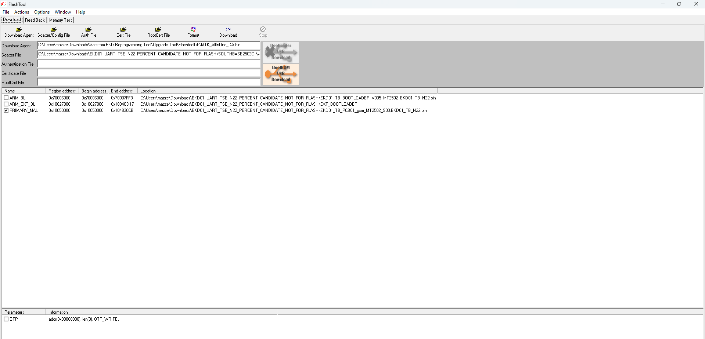

# TSDZ2 / EKD01 N22: 1% Battery SOC

This repository contains an experimental patch for one Tongsheng EKD01 display firmware: `EKD01_TB_N22` on the MT2502 platform. It changes how the N22 application interprets the battery value received from a compatible TSDZ2 controller, allowing the display and its BLE telemetry to report integer percentages instead of the stock 0-12 scale.

This is a paired modification. It requires both the patched N22 display application in this repository and TSDZ2 motor firmware built with `EKD01_SOC_PERCENT_MODE` enabled. Neither side alone provides the intended result.

> **Experimental firmware: use at your own risk.** Read the compatibility, backup, flashing, and disclaimer sections before using these files. This is not an official Tongsheng update or a universal EKD01 firmware.

---

## ☕ Support the Project

This project and firmware patch are provided **free of charge** for the e-bike community.

If you find this patch useful and want to support ongoing reverse-engineering, research, and development, tips and donations are greatly appreciated!

| Platform | Link | Description |
| :--- | :--- | :--- |
| ☕ **Ko-fi** | [](https://ko-fi.com/j4ckp0t85) | Send a one-time tip or buy a coffee via [ko-fi.com/j4ckp0t85](https://ko-fi.com/j4ckp0t85) |
| 💳 **PayPal** | [](https://www.paypal.com/donate/?business=ZDARGHTS7LUDA&no_recurring=1&currency_code=EUR) | Direct donation via [PayPal (EUR)](https://www.paypal.com/donate/?business=ZDARGHTS7LUDA&no_recurring=1&currency_code=EUR) |

---

## What Was Changed

The stock N22 application handles the battery value as a 0-12 value and scales it for display/telemetry as approximately 8.33 percentage points per step. The patched application changes both battery callback paths: the custom callback used by the tested setup and the default callback. Each path is changed to accept values up to 100 and to use a scale of 1.0 instead of approximately 8.33333.

The offsets below are relative to the 4,403,404-byte N22 application file `EKD01_TB_PCB01_gsm_MT2502_S00.EKD01_TB_N22.bin`. Byte sequences are shown in file order. They are not offsets into the separate 8 MiB raw flash image. In the verified full-flash layout, add `0x50000` to an application offset to obtain its raw-flash offset. The application runtime base used during analysis was `0x10050000`.

| Callback path | Application offset | Original bytes | Patched bytes | Effect |
| --- | ---: | --- | --- | --- |
| Custom | `0x10DF0E` | `0C 28` | `64 28` | Change the compare limit from 12 to 100 |
| Custom | `0x10DF12` | `0C 20` | `64 20` | Change the clamp value from 12 to 100 |
| Custom | `0x10DF50` | `55 55 05 41` | `00 00 80 3F` | Change the float scale from about 8.33333 to 1.0 |
| Default | `0x110FBA` | `0C 28` | `64 28` | Change the compare limit from 12 to 100 |
| Default | `0x110FBE` | `0C 20` | `64 20` | Change the clamp value from 12 to 100 |
| Default | `0x110FF8` | `55 55 05 41` | `00 00 80 3F` | Change the float scale from about 8.33333 to 1.0 |

There are six patch sites and 12 changed byte positions in total. The two float constants are IEEE-754 single-precision values in little-endian byte order: `55 55 05 41` is approximately 8.33333 and `00 00 80 3F` is 1.0. The limits and scaling instructions were checked against the disassembled callback paths and executed in a controlled analysis harness; that is not a substitute for testing on other display revisions.

## Required Motor Firmware

Build the matching TSDZ2 firmware from the compatible fork with:

```c
#define EKD01_SOC_PERCENT_MODE 1
```

In JavaConfigurator, this is the **Direct 1% SOC (patched N22 only)** option under **Basic settings > Display settings** for TSDZ2 + EKD01. `Compile & Flash` builds/updates the motor firmware; it does not patch or update the display. This option is off by default for stock displays. Load the intended preset before enabling it and confirm the generated setting afterwards.

The motor sends the existing 9-byte UART packet with the battery field encoded as an integer percentage from 0 to 100. The patched N22 consumes that value. The retired 24-byte extension is not used. Do not enable direct-percentage mode with an unmodified N22 display: it may interpret the value using the old scale and show an incorrect reading. Likewise, the patched display paired with the old motor format may still show only 0-12%.

This repository contains the display package, not the matching motor firmware source or a ready-to-flash motor image. Obtain and build that firmware separately from the compatible TSDZ2 firmware project.

## Included Display Package

The `EKD01_UART_TSE_N22_PERCENT/` directory contains the N22 package configuration, the required boot components, an auxiliary platform data file, and the patched main application. The configuration references the main application and boot components by the filenames present in that directory.

The patched main application has SHA-256:

```text
9478720ca0510e7e76f2124fe0eca4f974c3216e6e0d4374b9bf74d411b139c4
```

For comparison, the unmodified application used as the patch baseline had SHA-256:

```text
36dc7fe8716e30dd95f787aa2d96559643768679867bae9d0ffc290db02b3eb4
```

The tested application is specific to the `EKD01_TB_N22` build. Do not assume it is compatible with other EKD01 models, display hardware revisions, or firmware versions.

## Display Programming

Programming the display is separate from building/flashing the TSDZ2 motor firmware. The included Varstrom/Mtk tool package is third-party software. Follow its supplier's instructions and use it only if you are authorized to do so.



In the tested setup, only `PRIMARY_MAUI` was selected. Both bootloader entries were unchecked, `OTP` was unchecked, and no `Format` operation was performed. Do not select `Format`. The screenshot documents that tested selection; it is not a complete or universal flashing procedure.

Before any programming:

- Confirm the exact display model and firmware package. This patch is for the tested N22 application only.
- Preserve the original vendor package and make two matching, full flash readbacks using a method appropriate for the device. Verify that the readbacks match before proceeding.
- Do not overwrite or discard the original firmware or readbacks. A backup does not guarantee recovery from a failed write.
- Do not flash the bootloader entries or OTP for this application patch.
- After programming, verify startup and error status, then check that the physical display and the ApexDrive battery reading agree while stationary before riding.
- When restoring an unmodified display, also disable `EKD01_SOC_PERCENT_MODE` in the motor firmware.

The original vendor firmware and the Varstrom flashing utility are third-party materials.

## AI Assistance

AI tools assisted with reverse-engineering research, disassembly interpretation, patch/test development, and documentation. The results were reviewed and the patch was tested on the hardware described above by the project maintainer. AI assistance is not an independent certification, guarantee of correctness, or substitute for the user's own review and risk assessment.

## Disclaimer

This firmware and all accompanying instructions are provided **"AS IS"**, without warranties of any kind. Use, modification, and programming are entirely at your own risk. Incorrect firmware or a failed programming operation may make a display or motor unusable and may cause property damage or personal injury.

Michele Granato, the author/maintainer of this project, accepts no responsibility or liability for damage, loss, injury, or other consequences arising from the possession, use, modification, or programming of these files, to the maximum extent permitted by applicable law. Nothing in this notice excludes or limits liability where applicable law does not allow that exclusion or limitation. This is not a safety certification or a substitute for applicable laws, manufacturer instructions, or qualified technical support.

Tongsheng, EKD01, ApexDrive, Varstrom, and MediaTek are referenced only to identify relevant products and third-party materials. This project is not affiliated with or endorsed by those companies or product owners.